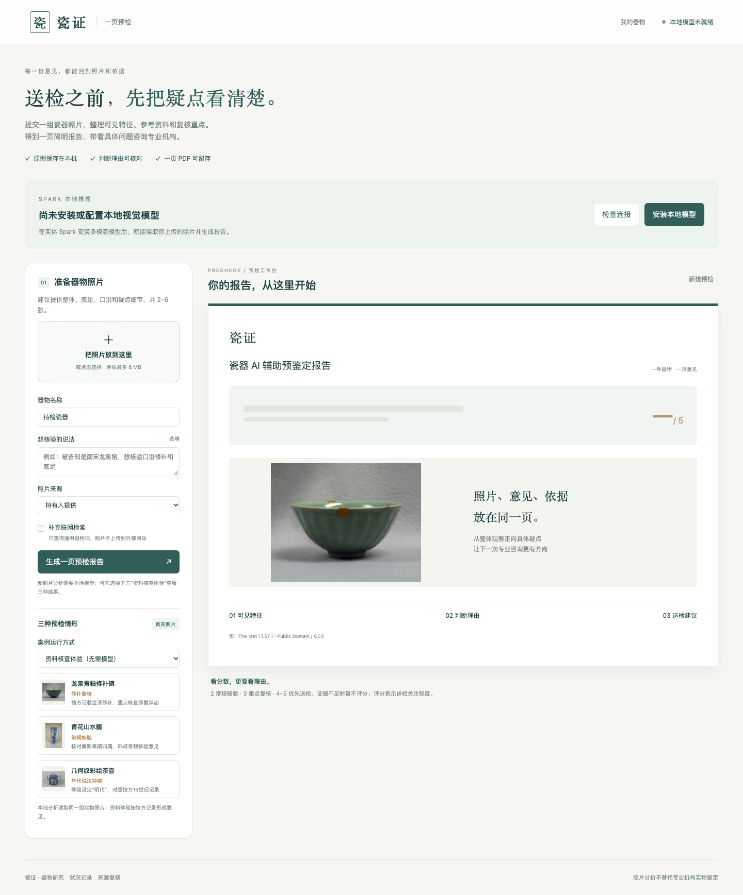
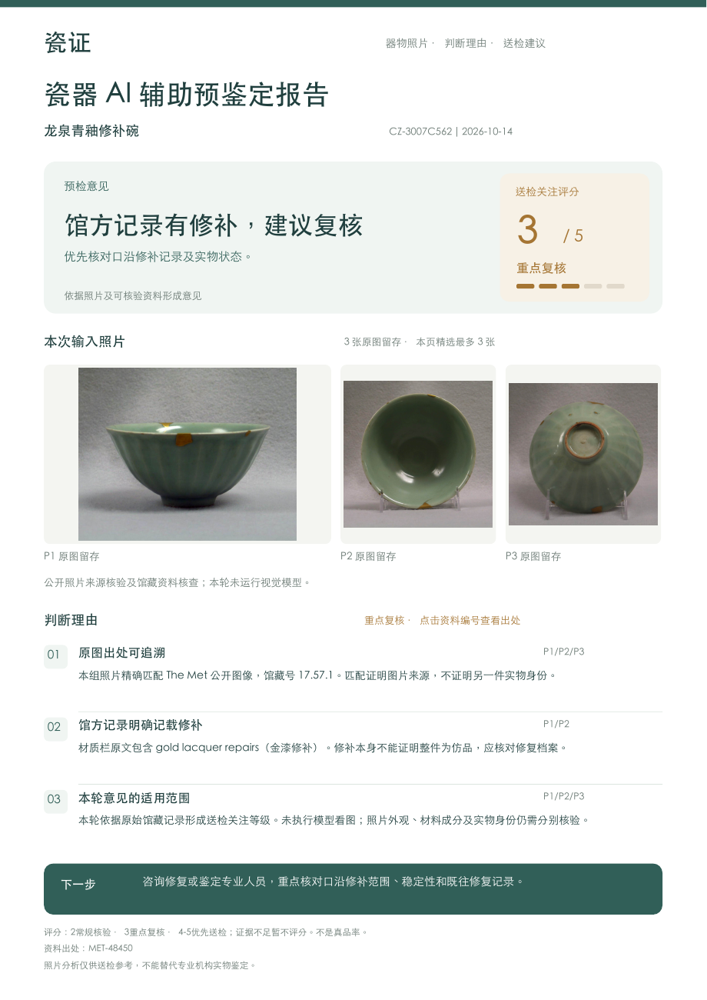
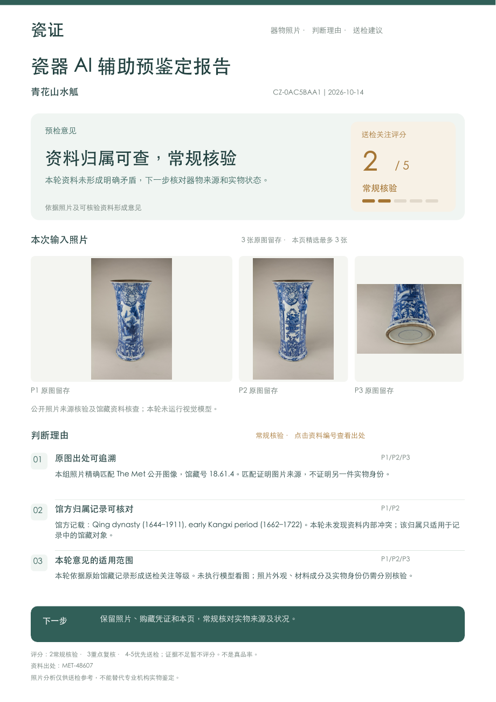
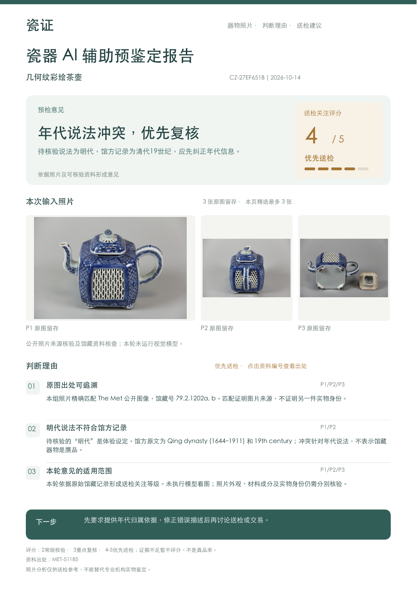
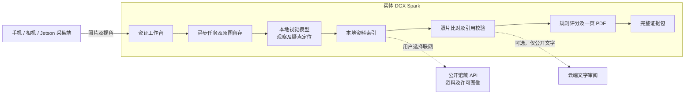

# 瓷证 · 一页预检

**送检之前，先把疑点看清楚。**

面向瓷器收藏爱好者的照片辅助预检工具。提交一件器物的整体、底足和局部照片，系统在本地读取图像，检索有出处的参考资料，核对引用及判断理由，生成一页简明 PDF：**预检意见、五级送检关注评分、真实照片、三条理由、下一步建议**。



这是一套可以安装的独立应用，包含前端、异步任务后台、本地模型适配、参考资料检索、原图留存、一页 PDF、证据包和 Spark 部署脚本。提交照片后即返回任务编号，前端查看处理进度；模型运行不再占用同一个长时间 HTTP 请求。

## 在自己的 Spark 上安装本地模型和完整应用

**模型就在 Spark 运行：Qwen3-VL-8B-Instruct 是多模态大语言模型，同一服务负责看图、比较参考资料和复核理由。**

取得仓库代码或解压 [最新安装包](https://github.com/dingyucanada/cizheng-spark-precheck/releases/latest)，在项目目录运行：

```bash
bash scripts/install-spark.sh --with-system-packages
```

安装程序包含 **权重下载、GPU 推理容器、真实图片探测、后台和网页、完整视觉报告验收**。完成后打开 <http://127.0.0.1:8790>。日后运行 `bash scripts/run-spark.sh` 即可启动。详细步骤见 **[从这里开始](START_HERE.md)**。

这份安装包可以交给其他 Spark 使用者在其设备上安装，不依赖作者的电脑、原比赛云节点或作者的 API 密钥。当前仓库为私有，有权访问者可以克隆，其他获授权使用者可通过安装包部署。

想让 Codex 完成安装，见 [Codex 部署交接](DEPLOY_WITH_CODEX.md)。技术说明：[完整部署](docs/SPARK_DEPLOY.md) · [系统架构](docs/ARCHITECTURE.md) · [评分规则](docs/SCORING.md)。

## 使用过程

1. 提交 **同一件器物的 2–6 张照片**，可填写希望核验的年代或窑口说法。原图保存，模型使用不含 EXIF 的预览副本。
2. Spark 上的视觉模型先观察照片，记录特征、疑点位置、可能的替代解释；这一步不提供馆藏标题，以减少资料对观察的诱导。
3. 检索本地资料；用户选择联网且部署允许时，补充查询 The Met 和芝加哥艺术博物馆的公开 API。联网只使用受控器物词，原图不外传。
4. 分清待检照片和参考器照片，比较特征及原始摘录；程序核验来源 ID、照片 ID 和逐字引用。未通过核验的引用不能进入评分。
5. 二次复核比较理由，按公开规则计算送检关注等级。模型失败时保留输入和阶段记录，不编造结果。
6. 下载一页 PDF；需要详细核对时，展开证据，或导出包含原图、完整 JSON、照片指纹和 PDF 的压缩包。



## 评分怎么读

| 显示 | 含义 |
|---|---|
| 暂不评分 | 照片、器物同一性或覆盖范围不足；先补证 |
| 2 / 5 常规核验 | 本轮没有形成明确矛盾，仍须核验来源及实物 |
| 3 / 5 重点复核 | 发现修补或异常候选，需要针对性复核 |
| 4 / 5 优先送检 | 有直接关联用户主张的疑点，通过引用和理由复核 |
| 5 / 5 优先送检 | 至少两个维度、两个来源机构存在待专家确认的矛盾 |

分数表示送检关注程度，不是真品率。修补不等于造假，未发现疑点也不等于真品。当前没有自动授予“1 分放心通过”的路径。

## 三种结果，三种复核重点

| 真实照片案例 | 资料核查体验结果 | 依据 |
|---|---|---|
| 龙泉青釉修补碗 | **3/5 · 重点复核修补** | 馆方明确记载金漆修补 |
| 青花山水觚 | **2/5 · 常规核验** | 精确图片来源及康熙早期归属记录可核对 |
| 几何纹彩绘茶壶 | **4/5 · 年代说法冲突** | 明代说法为体验设定，馆方实际记录为清代19世纪 |

| 修补复核 · 3/5 | 常规核验 · 2/5 | 年代说法冲突 · 4/5 |
|---|---|---|
| [](verification/v020-48450.pdf) | [](verification/v020-48607.pdf) | [](verification/v020-51185.pdf) |

选择“**Spark 本地模型分析**”，上述照片会实际进入本机视觉模型，分数由本次观察和证据决定。选择“资料核查体验”，则运行照片来源核验和馆藏原文规则；第三个案例辨别的是错误归属说法，不把真实馆藏说成赝品。

项目内含3件器物、9张The Met真实照片、原始馆藏记录，以及3条芝加哥艺术博物馆参考记录。没有使用AI生成器物照片。

**我的器物**按照片集合归档。多次打开同一案例不会反复新增器物或报告；明确点击“重新分析”才产生新报告版本。既有重复档案升级时归并显示，原始文件和旧报告仍可追溯。

## 部署结构



核心流程可离线运行，前提是模型、依赖及参考资料已下载。联网资料补充和云端文字复核是两个独立选项。云端文字复核结果不提高评分；私有观察、原图及持有人说明不进入该请求。当前无需 BaaS 或 BI 才能运行；多设备采集、机构账号及运营看板可以继续扩展。

## 本机试运行

Python 3.11+，建议 Python 3.12。Linux 安装中文字体 `fonts-wqy-zenhei`；macOS 可使用系统黑体。

```bash
python3 -m venv .venv
.venv/bin/python -m pip install -r requirements.lock
.venv/bin/python -m pip install --no-deps -e .
bash scripts/start.sh
```

打开 <http://127.0.0.1:8790>。尚未配置模型时，三个公开馆藏入口可用，新照片视觉研判会明确提示连接模型。要启用 Spark 模型，按 `.env.example` 创建 `.env`，并使用部署文档。

## 代码入口

| 目录 | 内容 |
|---|---|
| `cizheng_precheck/web/` | 上传、进度、报告预览、证据、器物档案和报告版本 |
| `api.py` / `engine.py` | HTTP 接口、任务队列、超时和取消、失败恢复 |
| `provider.py` / `schemas.py` | 本地多模态调用、结构化输出、公开文字审阅 |
| `knowledge.py` | 来源匹配、本地检索、馆藏 API、引用核验 |
| `policy.py` / `pdf_report.py` | 可解释评分和固定一页报告排版 |
| `knowledge/` | 有出处的原始资料和真实照片 |
| `scripts/` | 环境检查、安装、模型下载、启动、真实验收 |
| `tests/` | 正常路径、失败路径、隐私边界和评分约束 |

## 验证范围

本机工程验证和截图见 [验证记录](verification/RESULTS.md)。新实体 Spark 的 GPU 速度、模型视觉观察正确性和实际用户照片效果，应由该设备运行 `probe-model.py` 和 `acceptance.py --visual` 后形成记录。仓库不包含模型权重、私人照片、访问口令、历史 API 密钥或过去云节点账号。

公开资料来源和技术依据见 [来源及许可](THIRD_PARTY.md)。个人项目，不代表博物馆、模型厂商或鉴定机构背书。
